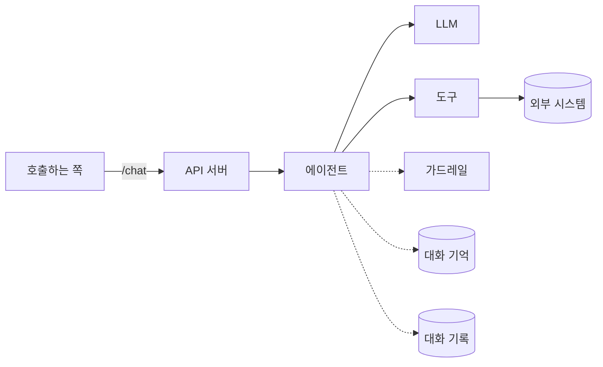
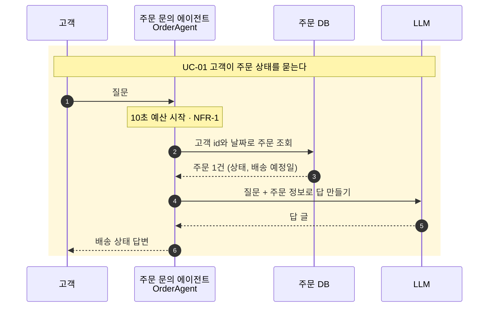

# Agent Design Document Guide

설계 문서는 **유스케이스 하나당 1개**다. 구현 문서를 따로 만들지 않는다.

에이전트는 같은 질문에도 LLM이 그때그때 다른 길을 고른다. 그래서 웹 백엔드 설계(`design-doc`)의 뼈대(전체 아키텍처, 시퀀스)에 **도구, 프롬프트·가드레일, 평가 질문** 칸을 더한다.

## 작성 원칙

1. **각 섹션은 그림 또는 표로 시작한다.** 평문은 그림을 보충하는 3줄 이내로 쓴다.
2. **비교는 표로 쓴다.** 산문으로 장단점을 늘어놓지 않는다.
3. **경로·구조는 `text` 블록 트리로 그린다.**
4. **문서 끝에 `> 한 줄:` 요약을 남긴다.**
5. 첫 h1은 유스케이스 한글명으로 쓴다 (예: `# 상품 문의 답변`). 리뷰 에이전트가 커밋 메시지에 사용한다.
6. 지금 필요하지 않은 것은 쓰지 않는다. 선택 섹션은 해당될 때만 만든다. "해당 없음" 칸을 만들지 않는다.

## 구성

| 구분 | 섹션 |
|---|---|
| 필수 | 1. 개요 · 2. 전체 아키텍처 · 3. 시퀀스 다이어그램 · 4. 도구 · 5. 프롬프트·가드레일 · 6. 평가 질문 목록 · 7. 구현 단계 |
| 선택 | 플로차트 · 디렉터리 구조 · 지식 검색 · 대화 기억·기록 · 결정 |

선택 섹션은 필수 섹션 사이 관련된 자리에 끼워 넣고, 번호는 순서대로 다시 매긴다.

---

## 필수 섹션

### 1. 개요

```text
- 무엇을: (3줄 이내)
- 누가 어디서 부르나: (호출하는 쪽 — 앱, 다른 서버 등)
- 흐름 방식: create_agent (LLM이 도구를 고름) / StateGraph (코드가 순서를 고정) — 고른 이유 한 줄
- 응답 방식: SSE 스트리밍 / 한 번에 응답
- 시간 제한: 호출하는 쪽 (기다려 주는 최대 시간, 모르면 "확인 필요") / 우리 쪽 (AGENT_TIMEOUT_SECONDS — 호출하는 쪽보다 2~3초 짧게, 모르면 30초)
- Out of Scope: (이 에이전트가 하지 않는 일)
- 기존 영향: 기존 연결 창구·도구·API를 건드리는 경우만. 없으면 "없음"
```

- **흐름 방식은 어느 쪽을 골랐든 이유를 한 줄 적는다.** 순서가 정해진 일이면 `StateGraph`를 먼저 검토한다. LLM이 길을 고르게 하면 지연 시간과 비용이 늘고 같은 질문에도 다른 길로 갈 수 있다. 고르는 기준은 `python:langgraph-conventions`를 따른다.
- 응답 방식의 기준은 `python:fastapi-conventions`를 따른다. 기준과 다르게 갈 때만 결정 섹션에 이유를 적는다.

### 2. 전체 아키텍처

`flowchart LR`로 호출하는 쪽부터 외부 시스템까지 한 그림에 그린다.



- 노드는 한글 역할명으로 쓴다. 쓰지 않는 칸(지식 검색, 대화 기억 등)은 그리지 않는다.
- 연결 창구(`app/infrastructure/`)를 거치는 것은 점선으로 그린다.

### 3. 시퀀스 다이어그램

`sequenceDiagram`으로 그린다. **시퀀스만 보고도 요구사항·NFR과 짝이 맞고, 구성 요소마다 꼭 필요한지 따질 수 있어야 한다.** 어디가 느리고 무엇을 빼거나 합칠 수 있는지를 구현하기 전에 여기서 찾는다.

**구간 나누기**

- **요구사항 문서의 유스케이스 표 한 줄이 구간 하나다** (`requirements-definition` 1단계 ④). 구간은 `rect`로 묶고, 첫 줄 `Note over`에 UC ID와 유스케이스 이름(누가 무엇을 한다)을 적는다. 예: `UC-01 고객이 주문 상태를 묻는다`. 유스케이스 표가 없으면 설계 전에 먼저 만든다.
- 구간 이름에 기술 분류("실패 처리", "시간 초과")를 쓰지 않는다. 어느 요구사항·NFR과 짝인지는 구간 목록 표(UC ID | 요구사항 | NFR)에 따로 적는다.
- 같은 장면 안의 갈래(다시 시도, 예외 입력, 실패 종류)는 구간을 나누지 않고 `alt` / `opt`로 그린다.
- **실패를 그리는 구간은 갈래 이름을 모두 실패 이유로 짓는다.** 중간 단계의 성공(`읽음`, `질문 있음`)만 이름으로 쓰면 그 갈래가 잘 된 경우로 읽힌다. 앞 단계는 됐고 다음 단계에서 실패하는 갈래는 `[된 것] → [실패한 것]`으로 쓴다. 실패 이유마다 ①②… 번호를 붙이고, 같은 번호를 실패 이유 표(예외, 던지는 곳, 다시 시도하나)에도 단다.

```text
alt ① 질문이 없음
else 질문은 있음 → 서비스에서 실패
    alt ② 주문을 못 읽음 (DB 고장)
    else 주문은 읽음 → LLM 답을 못 받음
        alt ③ 4xx (설정이 틀림)
        else ④ 금방 돌아온 실패가 두 번
        else ⑤ 시간 초과
```

- 구간마다 대표 질문을 한 줄로 적는다. 예: `대표 질문: "이 상품 지금 주문하면 언제 와?"`
- `autonumber`로 화살표에 번호를 붙인다. 아래 점검 표가 이 번호를 쓴다.
- NFR이 걸리는 자리는 그림 안에 `Note over`로 적는다. 예: `NFR-1: 10초 예산 시작`, `NFR-3: 질문당 DB 1번`
- 최소한 **외부 시스템(도구·DB·LLM) 실패**와 **시간 초과**는 어느 구간에든 갈래로 그린다.



**화살표 점검 표**

구간마다 그림 아래에 둔다. 바깥으로 나가는 화살표(LLM, DB, 외부 API, 다른 서버, 파일)만 적는다. 코드 안의 메서드 호출은 적지 않는다.

| 번호 | 화살표 | 걸리는 시간 (대략) | 꼭 필요한가 | 요구사항·NFR |
|---|---|---|---|---|
| 3 | 에이전트 → 주문 DB: 주문 조회 | 같은 데이터센터 왕복 0.5ms + 쿼리. 연결 풀로 재사용 | 필요. 캐시는 두지 않는다 (질문당 1번, 수 ms) | 요구사항 2, NFR-1 |
| 5 | 에이전트 → LLM: 답 만들기 | 1~3초 | 필요. 의도 분류 호출과 합칠지 따졌다: 합치면 1번 줄지만 프롬프트가 두 일을 맡아 정확도가 떨어진다 | 요구사항 1, NFR-1 |

- "꼭 필요한가"에는 빼거나, 합치거나, 미리 읽어 두면 어떻게 되는지를 한 줄로 쓴다. 표준 답(캐시를 둔다, 저장소를 나눈다)을 그대로 쓰지 않고, 이 시스템의 호출 횟수와 걸리는 시간으로 판단한다.
- 걸리는 시간은 연산별 기준으로 가늠한다 (`requirements-definition`의 "생각하는 법" 표). 다른 서버로 보내는 HTTP는 연결을 새로 맺으면 TCP·TLS 시간이 더해지므로, 연결을 재사용하는지 함께 적는다.
- 점검으로 바뀐 설계는 "결정" 표에 남기고, 다이어그램 끝에 "시퀀스에서 나온 설계 선택"을 목록으로 모은다.

**그리는 법**

- **참여자는 한글 역할명으로 쓰고 코드·기술 이름을 병기한다.** 예: `participant T as 상품 조회 도구<br/>get_product`, `participant V as 문서 검색<br/>벡터 색인`. **클래스·함수 이름은 참여자 상자에만 쓴다.**
- **화살표 글만 읽어도 무슨 작업인지 보여야 한다.** 그림은 흐름과 시간을 따지는 곳이고, 코드와의 대응은 디렉터리 구조 절이 맡는다.

| 자리 | 쓰는 법 | 예 |
|---|---|---|
| 요청 화살표 | "[무엇으로] [무엇을 한다]". 입력이 뻔하면 작업만 | `질문 + 주문 정보로 답 만들기`, `조회 키로 주문 조회`, `주문 목록 조회` |
| 응답 화살표 | 받은 것. 괄호에는 담긴 항목이나 값 | `주문 1건 (상태, 결제 시각)`, `검사 결과 (통과)` |
| 괄호 | 데이터만: 필드, 값, 고를 수 있는 값. 다른 시스템과 주고받는 약속(State 키 등)은 남긴다 | `(order_id)`, `(정책 / 개인화 / 범위 밖)`, `(check_result = PASS)` |
| 메모 (`Note over`) | NFR과 안쪽 처리를 문장으로. 클래스 이름을 쓰지 않는다 | `10초 예산 시작 · NFR-1`, `취소할 수 있는지 판단` |

- 쓰지 않는 글: 값·변수만(`State (…)`, `"pass"`), 질문 원문만(`"어제 주문한 거…"` → `질문`), 함수 시그니처나 함수 이름(`route_after_check(state)` → `판정 결과로 다음 노드 고르기`), 메모 속 클래스 이름(`TimeLimit: 예산 시작` → `10초 예산 시작`).
- **LLM의 판단은 `Note over`로 적는다.** 예: "상품 조회 도구가 필요하다고 판단".
- 에이전트 전체를 설계할 때는 입력 가드레일(LLM 전)과 출력 가드레일(LLM 후)을 반드시 그린다.
- 요청은 실선 `->>`, 응답은 점선 `-->>`.
- 한 구간의 참여자는 5~7개 이내로 둔다.

### 4. 도구

| 도구 | 하는 일 | 언제 쓰나 / 쓰지 않나 | 입력 | 실패 시 | 사람 확인 |
|---|---|---|---|---|---|

- "언제 쓰나 / 쓰지 않나" 열은 도구 독스트링(LLM이 읽는 설명)의 초안이다.
- **비슷한 도구가 있으면 서로의 경계를 "쓰지 않나"에 적는다** (예: "주문 전 예상 도착일에는 쓰지 않는다. 그때는 도착일 계산 도구"). LLM은 도구 수보다 겹치는 도구 때문에 헷갈린다.
- "사람 확인" 열에는 실행 전에 사람이 확인해야 하는지 적는다. 조회만 하는 도구는 "불필요", 돈이 움직이거나 되돌릴 수 없는 일(취소, 환불, 결제, 발송)을 하는 도구는 "필요"다. 구현은 `python:langgraph-conventions`의 "사람 확인"을 따른다.
- 사람 확인이 이번 범위 밖이면 "필요 — 이번 범위에서 뺌"이라고 적고, 결정 섹션에 뺀 이유와 받아들이는 위험(예: "분명한 요청에만 취소"를 프롬프트로만 지킨다)을 적는다. "불필요"로 바꿔 적지 않는다.
- "실패 시" 열에는 업무 결과로서의 실패(결과 없음, 권한 없음, 규칙에 걸림)에 LLM에게 돌려줄 문장을 적는다. 외부 시스템 고장은 도구가 문장으로 바꾸지 않고 `UPSTREAM_ERROR`로 끝나므로 적지 않는다 (`python:agent-architecture`의 "예외 위치").
- 금액 계산, 날짜 판단, 권한 확인처럼 답이 하나여야 하는 일은 LLM이 아니라 도구(코드)가 맡는다.

### 5. 프롬프트·가드레일

| 구분 | 내용 | 지키는 곳 | 위반 시 |
|---|---|---|---|
| 역할 | 에이전트가 맡는 역할과 말투 | 프롬프트 | — |
| 금지 주제 | 답하지 않을 질문 | 프롬프트 + 입력 가드레일 | 안내 문구 |
| 입력 검사 | 개인정보, 악성 지시 등 | 입력 가드레일 (LLM 전) | |
| 출력 검사 | 개인정보 노출, 근거 없는 약속 등 | 출력 가드레일 (LLM 후) | |
| 필수 규칙 | 반드시 지켜야 하는 업무 규칙 | 코드 | |

- 꼭 지켜야 하는 규칙은 프롬프트에만 두지 않고 코드(가드레일·도구)에 둔다. LLM은 프롬프트를 어길 수 있다.
- 프롬프트 전문은 문서에 쓰지 않는다. `app/prompts/` 파일 이름과 핵심 지시만 적는다.

### 6. 평가 질문 목록

| # | 질문 | 기대 동작 | 유형 |
|---|---|---|---|
| 1 | | 써야 할 도구, 답에 들어갈 핵심 | 정상 |
| 2 | | | 도구 실패 / 결과 없음 |
| 3 | | | 가드레일 (막아야 함) |

- 정상, 실패, 가드레일 유형을 모두 넣는다. 설계 때는 10개 안팎으로 시작하고, 구현 뒤 실제 답을 보면서 20개 이상으로 늘린다.
- 질문은 지어내지 않고 손으로 확인하던 항목과 사용자가 자주 하는 요청에서 뽑는다. 새 프로젝트라 그런 자료가 없으면 요구사항과 도구 표(정상·실패 문장)에서 뽑고, 출처를 "요구사항"으로 적는다.
- 이 목록이 `evals/`의 질문 파일과 2층 흐름 테스트(`python:python-testing`)의 재료가 된다.
- **채점 방식은 이 문서에서 정하지 않는다.** 구현 후 실제 답을 보고 사용자와 함께 정한다.

### 7. 구현 단계

| 단계 | 대상 | 선행 |
|---|---|---|
| 0 | 설정·의존성 (`pyproject.toml`, `.env.example`) | — |
| 1 | 도메인 (`app/domain/<기능>/` — 도메인 객체, 업무 규칙, 업무 예외. 규칙이 없으면 값만 갖는 객체와 대상 없음 예외) | 0 |
| 2 | 연결 창구 (`app/application/<기능>/port.py` Protocol + `app/infrastructure/` 로컬 구현 + `Platform` 칸·`local.py`·`tests/fakes.py`의 `fake_platform`) | 1 |
| 3 | 유스케이스와 서비스 (`app/application/<기능>/` — `usecase.py`, `command.py`, `result.py`, `service.py`) | 2 |
| 4 | 도구 (`app/infrastructure/tools/` — `<기능>Tools` 클래스) | 3 |
| 5 | 프롬프트 (`app/prompts/`) | 0 |
| 6 | 채팅 기능 (`app/application/agent/` — `ChatUseCase`, `ChatService`, `ChatCommand`)과 조립 (`app/container.py`의 `Container`). 답 만들기 어댑터는 뼈대의 것을 쓴다 | 4, 5 |
| 7 | API (`app/presentation/` — `/chat`, `/health`, 새 예외의 오류 대응. `main.py`는 `Container`를 부르기만) | 6 |
| 8 | 평가 질문 (`evals/`) | 7 |

- 단계 하나가 체크포인트 하나에 대응한다 (`implementation-checkpoint` 스킬).
- 대상 열에는 이 유스케이스에서 실제로 만들 파일·클래스·함수 이름을 적는다.
- 변경이 없는 단계는 뺀다. 필요한 단계는 추가한다. 빼거나 더한 뒤 번호는 0부터 순서대로 다시 매긴다.
- **함수별 상세 명세는 쓰지 않는다.** 시그니처는 단계 시작 직전 체크포인트에서 제시하고 승인받는다.

---

## 선택 섹션

### 플로차트 — StateGraph일 때

순서를 코드로 고정하는 흐름이면 `flowchart TD`로 노드와 분기를 그린다. 노드 이름은 코드의 노드 이름과 같게 쓴다.

### 디렉터리 구조 — 새 파일이 있을 때

폴더 뼈대는 `python:python-project`에 고정돼 있다. **이 유스케이스에서 새로 생기는 파일만** `text` 트리로 적는다.

### 지식 검색 — RAG를 쓸 때

| 자료 | 찾는 방법 | 몇 개 가져오나 | 결과 없을 때 |
|---|---|---|---|

### 대화 기억·기록 — 여러 번 주고받거나 감사 기록이 필요할 때

| 구분 | 저장소 | 유지 시간 | 저장 항목 |
|---|---|---|---|
| 대화 기억 | | (예: 24시간) | 최근 대화 |
| 대화 기록 | | 보관 기준 | 질문·답 (가드레일을 거친 뒤 내용) |

유지 시간과 보관 기준은 추측하지 않는다. 확인되지 않았으면 "확인 필요"로 적고 사용자에게 묻는다.

### 결정 — 기준과 다르게 가거나 대안이 있었을 때

| 항목 | 선택 | 대안 | 안 고른 이유 |
|---|---|---|---|

- 브레인스토밍에서 사용자와 합의한 결정을 한 줄씩 옮긴다.
- 명백한 기본값은 적지 않는다. 다르게 갈 수 있었던 것만 적는다.

---

## 예외 상황은 어디에

따로 섹션을 두지 않는다.

| 예외 | 적는 곳 |
|---|---|
| 결과 없음, 규칙에 걸림 | 4. 도구의 "실패 시" 열 |
| 시간 초과, LLM 출력 형식 깨짐 | 3. 시퀀스 다이어그램의 `alt` |
| 막아야 할 질문 | 5. 프롬프트·가드레일 |
| 새 예외 클래스, 새 오류 `code` | 결정 섹션에 이유를 적고, 7. 구현 단계의 대상 열에 넣는다 (`app/common/errors.py`의 예외, `app/presentation/exception/error_rule.py`의 `ErrorRuleBook` 대응표) |

- 뼈대에 있는 예외(`AppError`, `UpstreamError`, `AgentTimeoutError`)와 오류 응답 표(`python:fastapi-conventions`)로 충분하면 적지 않는다.
- 새 오류 `code`는 사용자 확인이 필요하다 (`python:fastapi-conventions`).

## 쓰지 않는 것

| 항목 | 이유 |
|---|---|
| 호출 계약 표 (`/chat` 요청·응답) | `python:fastapi-conventions` 표준을 따른다. 다를 때만 개요에 적는다 |
| 프롬프트 전문 | `app/prompts/` 파일과 이중관리가 된다 |
| 채점 방식 | 구현 후 실제 답을 보고 사용자와 정한다 |
| 테스트 전략 | `python:python-testing` 스킬에 있다 |
| 연결 창구 목록 | `python:agent-architecture` 스킬에 있다 |
| 함수·클래스 명세 | 코드와 이중관리가 된다. 체크포인트가 대체한다 |

필요해지면 그때 추가한다.
