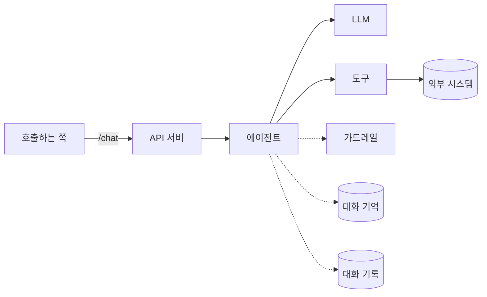

# Agent Design Document Guide

설계 문서는 **유스케이스 하나당 1개**다. 구현 문서를 따로 만들지 않는다.

에이전트는 같은 질문에도 LLM이 그때그때 다른 길을 고른다. 그래서 웹 백엔드 설계(`design-doc`)의 뼈대(전체 아키텍처, 시퀀스)에 **도구, 프롬프트·가드레일, 평가 질문** 칸을 더한다.

## 작성 원칙

1. **각 섹션은 그림 또는 표로 시작한다.** 평문은 그림을 보충하는 3줄 이내로 쓴다.
2. **비교는 표로 쓴다.** 산문으로 장단점을 늘어놓지 않는다.
3. **경로·구조는 `text` 블록 트리로 그린다.**
4. **문서 끝에 `> 한 줄:` 요약을 남긴다.**
5. 첫 h1은 유스케이스 한글명으로 쓴다 (예: `# 상품 문의 답변`). 리뷰 에이전트가 커밋 메시지에 사용한다.
6. 지금 필요하지 않은 것은 쓰지 않는다. 선택 섹션은 해당될 때만 만든다. "해당 없음" 칸을 만들지 않는다.

## 구성

| 구분 | 섹션 |
|---|---|
| 필수 | 1. 개요 · 2. 전체 아키텍처 · 3. 시퀀스 다이어그램 · 4. 도구 · 5. 프롬프트·가드레일 · 6. 평가 질문 목록 · 7. 구현 단계 |
| 선택 | 플로차트 · 디렉터리 구조 · 지식 검색 · 대화 기억·기록 · 결정 |

선택 섹션은 필수 섹션 사이 관련된 자리에 끼워 넣고, 번호는 순서대로 다시 매긴다.

---

## 필수 섹션

### 1. 개요

```text
- 무엇을: (3줄 이내)
- 누가 어디서 부르나: (호출하는 쪽 — 앱, 다른 서버 등)
- 흐름 방식: create_agent (LLM이 도구를 고름) / StateGraph (코드가 순서를 고정)
- 응답 방식: SSE 스트리밍 / 한 번에 응답
- 시간 제한: (호출하는 쪽이 기다려 주는 최대 시간)
- Out of Scope: (이 에이전트가 하지 않는 일)
- 기존 영향: 기존 연결 창구·도구·API를 건드리는 경우만. 없으면 "없음"
```

흐름 방식과 응답 방식의 기준은 `python:langgraph-conventions`, `python:fastapi-conventions`를 따른다. 기준과 다르게 갈 때만 결정 섹션에 이유를 적는다.

### 2. 전체 아키텍처

`flowchart LR`로 호출하는 쪽부터 외부 시스템까지 한 그림에 그린다.



- 노드는 한글 역할명으로 쓴다. 쓰지 않는 칸(지식 검색, 대화 기억 등)은 그리지 않는다.
- 연결 창구(`app/platform/`)를 거치는 것은 점선으로 그린다.

### 3. 시퀀스 다이어그램

`sequenceDiagram`으로 **대표 질문 하나**의 흐름을 그린다. 에이전트는 질문마다 길이 달라서 모든 경우를 그리지 않는다.

- 대표 질문을 다이어그램 위에 한 줄로 적는다. 예: `대표 질문: "이 상품 지금 주문하면 언제 와?"`
- **참여자는 한글 역할명으로 쓰고 코드 이름을 병기한다.** 예: `participant T as 상품 조회 도구<br/>get_product`
- **메시지는 "무엇을 하는지" 한글로 쓴다.** 함수 시그니처를 라벨로 쓰지 않는다.
- **LLM의 판단은 `Note over`로 적는다.** 예: "상품 조회 도구가 필요하다고 판단".
- 입력 가드레일(LLM 전)과 출력 가드레일(LLM 후)을 반드시 그린다.
- 실패는 `alt` / `else`로 같은 다이어그램에 그린다. 최소한 **도구 실패**와 **시간 초과**를 넣는다.
- 요청은 실선 `->>`, 응답은 점선 `-->>`.
- 참여자는 5~7개 이내로 둔다.

### 4. 도구

| 도구 | 하는 일 | 언제 쓰나 / 쓰지 않나 | 입력 | 실패 시 |
|---|---|---|---|---|

- "언제 쓰나 / 쓰지 않나" 열은 도구 독스트링(LLM이 읽는 설명)의 초안이다.
- "실패 시" 열에는 LLM에게 돌려줄 문장 또는 처리 방법을 적는다 (외부 시스템 오류, 결과 없음, 권한 없음).
- 금액 계산, 날짜 판단, 권한 확인처럼 답이 하나여야 하는 일은 LLM이 아니라 도구(코드)가 맡는다.

### 5. 프롬프트·가드레일

| 구분 | 내용 | 지키는 곳 | 위반 시 |
|---|---|---|---|
| 역할 | 에이전트가 맡는 역할과 말투 | 프롬프트 | — |
| 금지 주제 | 답하지 않을 질문 | 프롬프트 + 입력 가드레일 | 안내 문구 |
| 입력 검사 | 개인정보, 악성 지시 등 | 입력 가드레일 (LLM 전) | |
| 출력 검사 | 개인정보 노출, 근거 없는 약속 등 | 출력 가드레일 (LLM 후) | |
| 필수 규칙 | 반드시 지켜야 하는 업무 규칙 | 코드 | |

- 꼭 지켜야 하는 규칙은 프롬프트에만 두지 않고 코드(가드레일·도구)에 둔다. LLM은 프롬프트를 어길 수 있다.
- 프롬프트 전문은 문서에 쓰지 않는다. `app/prompts/` 파일 이름과 핵심 지시만 적는다.

### 6. 평가 질문 목록

| # | 질문 | 기대 동작 | 유형 |
|---|---|---|---|
| 1 | | 써야 할 도구, 답에 들어갈 핵심 | 정상 |
| 2 | | | 도구 실패 / 결과 없음 |
| 3 | | | 가드레일 (막아야 함) |

- 정상, 실패, 가드레일 유형을 모두 넣는다. 처음에는 10개 안팎으로 시작한다.
- 이 목록이 `evals/`의 질문 파일과 2층 흐름 테스트(`python:python-testing`)의 재료가 된다.
- **채점 방식은 이 문서에서 정하지 않는다.** 구현 후 실제 답을 보고 사용자와 함께 정한다.

### 7. 구현 단계

| 단계 | 대상 | 선행 |
|---|---|---|
| 0 | 설정·의존성 (`pyproject.toml`, `.env.example`) | — |
| 1 | 연결 창구 (`app/platform/` Protocol + 로컬 구현) | 0 |
| 2 | 업무 규칙 (`app/domain/`, 있을 때만) | 1 |
| 3 | 도구 (`app/tools/`) | 1 |
| 4 | 프롬프트 (`app/prompts/`) | 0 |
| 5 | 에이전트 흐름 (`app/agent/`) | 3, 4 |
| 6 | API (`main.py` — `/chat`, `/health`) | 5 |
| 7 | 평가 질문 (`evals/`) | 6 |

- 단계 하나가 체크포인트 하나에 대응한다 (`implementation-checkpoint` 스킬).
- 대상 열에는 이 유스케이스에서 실제로 만들 파일·클래스·함수 이름을 적는다.
- 변경이 없는 단계는 뺀다. 필요한 단계는 추가한다.
- **함수별 상세 명세는 쓰지 않는다.** 시그니처는 단계 시작 직전 체크포인트에서 제시하고 승인받는다.

---

## 선택 섹션

### 플로차트 — StateGraph일 때

순서를 코드로 고정하는 흐름이면 `flowchart TD`로 노드와 분기를 그린다. 노드 이름은 코드의 노드 이름과 같게 쓴다.

### 디렉터리 구조 — 새 파일이 있을 때

폴더 뼈대는 `python:python-project`에 고정돼 있다. **이 유스케이스에서 새로 생기는 파일만** `text` 트리로 적는다.

### 지식 검색 — RAG를 쓸 때

| 자료 | 찾는 방법 | 몇 개 가져오나 | 결과 없을 때 |
|---|---|---|---|

### 대화 기억·기록 — 여러 번 주고받거나 감사 기록이 필요할 때

| 구분 | 저장소 | 유지 시간 | 저장 항목 |
|---|---|---|---|
| 대화 기억 | | (예: 24시간) | 최근 대화 |
| 대화 기록 | | 보관 기준 | 질문·답 (가드레일을 거친 뒤 내용) |

유지 시간과 보관 기준은 추측하지 않는다. 확인되지 않았으면 "확인 필요"로 적고 사용자에게 묻는다.

### 결정 — 기준과 다르게 가거나 대안이 있었을 때

| 항목 | 선택 | 대안 | 안 고른 이유 |
|---|---|---|---|

- 브레인스토밍에서 사용자와 합의한 결정을 한 줄씩 옮긴다.
- 명백한 기본값은 적지 않는다. 다르게 갈 수 있었던 것만 적는다.

---

## 예외 상황은 어디에

따로 섹션을 두지 않는다.

| 예외 | 적는 곳 |
|---|---|
| 도구 오류, 결과 없음 | 4. 도구의 "실패 시" 열 |
| 시간 초과, LLM 출력 형식 깨짐 | 3. 시퀀스 다이어그램의 `alt` |
| 막아야 할 질문 | 5. 프롬프트·가드레일 |

## 쓰지 않는 것

| 항목 | 이유 |
|---|---|
| 호출 계약 표 (`/chat` 요청·응답) | `python:fastapi-conventions` 표준을 따른다. 다를 때만 개요에 적는다 |
| 프롬프트 전문 | `app/prompts/` 파일과 이중관리가 된다 |
| 채점 방식 | 구현 후 실제 답을 보고 사용자와 정한다 |
| 테스트 전략 | `python:python-testing` 스킬에 있다 |
| 연결 창구 목록 | `python:agent-architecture` 스킬에 있다 |
| 함수·클래스 명세 | 코드와 이중관리가 된다. 체크포인트가 대체한다 |

필요해지면 그때 추가한다.
