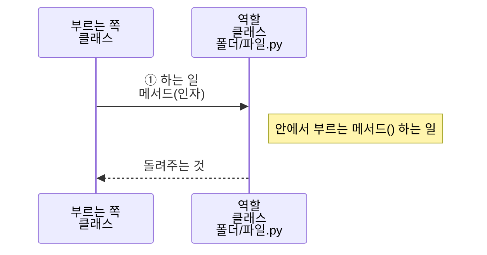
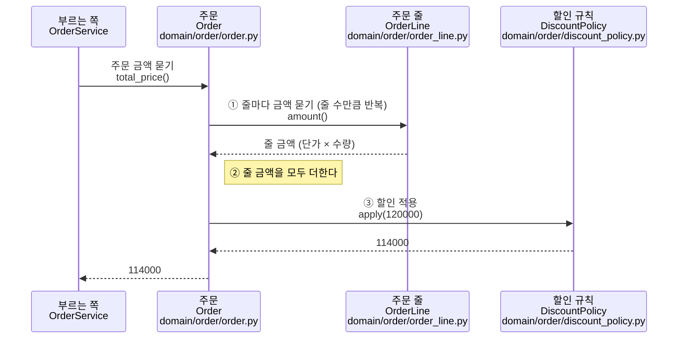
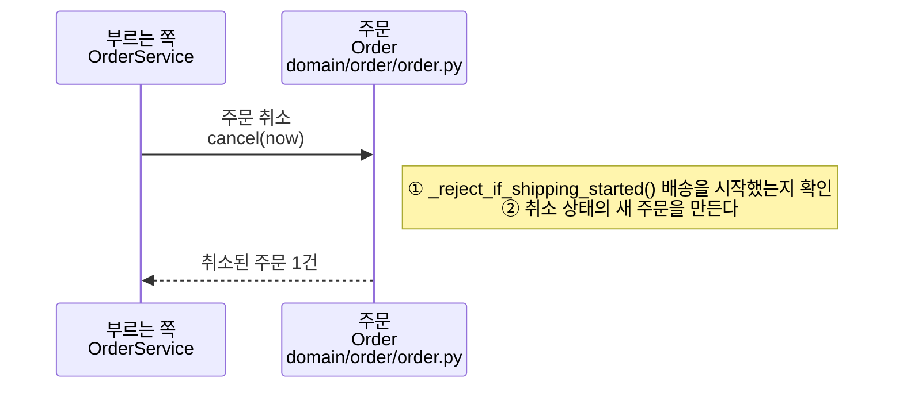

# 코드 시퀀스

폴더 하나를 읽고, 그 폴더가 하는 일과 그때 어느 파일의 어느 클래스·메서드가 어떤 순서로 불리는지 문서 하나로 정리한다.
읽기 전용이다. 코드를 고치지 않는다.

`code-map`은 파일 단위(파일마다 무슨 일을 하나), 이 스킬은 메서드 단위(일 하나가 어떤 메서드 순서로 처리되나)다.

## 절차

1. **대상을 정한다.** 인자로 받은 폴더를 쓴다. 없으면 지금 대화에서 다루는 폴더를 쓴다. 그것도 없으면 경로를 묻는다.
2. **파일을 모두 읽는다.** 메서드 이름으로 하는 일을 추측하지 않는다. 본문을 읽고 정한다.
3. **큰 일을 뽑는다.** 그 폴더가 바깥에 해 주는 일을 3개 안팎으로 적는다. (아래 "큰 일 쓰는 법")
4. **큰 일마다 세부 일을 적는다.** 세부 일 하나에 메서드 하나를 짝짓는다.
5. **실제 순서를 확인한다.** 호출하는 코드를 따라가서 세부 일을 코드가 도는 순서로 놓고 ①②…를 붙인다. 순서를 짐작하지 않는다.
6. **문서 파일을 쓴다.** (아래 "출력 형식"). 설계 문서 안에 넣지 않고 따로 파일로 만든다.
7. **대화에는 표와 파일 경로만 보여 준다.** 문서 내용을 길게 되풀이하지 않는다.

테스트·캐시·생성된 파일은 뺀다.

## 파일 위치와 이름

| 경우 | 위치 |
|---|---|
| 그 기능의 설계 문서 폴더가 있다 | 설계 문서 옆 (`docs/specs/<기능>/<폴더 이름>-시퀀스.md`) |
| 없다 | `docs/<폴더 이름>-시퀀스.md` |

폴더 이름은 사람이 부르는 이름으로 쓴다 (예: `도메인-시퀀스.md`, `application-시퀀스.md`).

## 출력 형식

순서와 모양을 바꾸지 않는다. **표는 이것 하나만 둔다.**

````markdown
# <폴더 이름> 시퀀스

<폴더 경로>가 하는 일과, 그때 어느 파일의 어느 클래스·메서드가 어떤 순서로 불리는지 정리한 문서다.

## <폴더 이름>이 하는 일

큰 일 N가지가 있고, 세부 일 하나에 메서드 하나가 맡겨져 있다. 번호(①②…)는 코드가 실제로 도는 순서다.

| 큰 일 | 세부 일 | 파일 | 클래스.메서드 |
|---|---|---|---|
| 1. ... | ① ... | `파일.py` | `클래스.메서드()` |
| | ② ... | `파일.py` | `클래스.메서드()` |
| 2. ... | ① ... | `파일.py` | `클래스.메서드()` |

- <이 폴더가 하지 않는 일과 그 일을 하는 곳> (있을 때만)
- <규칙에 걸리면 무엇을 던지는지> (있을 때만)

## 시퀀스 읽는 법

| 그림 요소 | 적힌 것 |
|---|---|
| 상자 | 역할 / 클래스 / 파일 |
| 화살표 첫 줄 | 위 표의 번호와 하는 일 |
| 화살표 둘째 줄 | 부르는 메서드 |
| 메모 (Note) | 그 클래스가 안에서 부르는 메서드 |

## 1. <큰 일 1>



## 2. <큰 일 2>
...
````

- 표의 "시퀀스 읽는 법"은 그림이 하나라도 있으면 넣는다. 그 밖의 표(규칙 표, 점검표, 읽는 순서)는 덧붙이지 않는다. 사용자가 요청하면 그때 넣는다.
- 그림 밖의 설명은 그림마다 2줄 이내로 쓴다.

## 큰 일 쓰는 법

읽는 사람이 다시 묻지 않아도 되게, 쉬운 말로 구체적으로 쓴다.

| 규칙 | 나쁜 예 | 좋은 예 |
|---|---|---|
| 무엇을 받아 무엇을 하는지 적는다 | 주문 목록을 검사하고 정렬한다 | DB에서 조회한 주문 줄에 빈 칸이나 겹친 상품이 없는지 확인하고, 상품 코드 순으로 줄 세운다 |
| 내부 용어를 쓰지 않는다 | 한 줄 검사 | 주문 줄 하나의 네 칸(상품, 수량, 단가, 통화)에 빈 칸이 없는지 확인 |
| 예를 넣는다 | 조사를 맞춘다 | 이름 뒤의 조사를 맞춘다 (과 → 와) |
| 3개 안팎으로 묶는다 | 세부 일 11개를 그대로 나열 | 큰 일 3개 아래에 세부 일을 나눠 넣는다 |
| 언제 도는지 드러낸다 | 값을 확인한다 | 서버가 켜질 때 한 번, 설정값이 비었는지 확인한다 |

- 큰 일은 "값을 받아 무엇을 해 준다"로 읽혀야 한다. 계산기라면 "더한다", "곱한다"에 해당하는 높이다.
- 확인·검증·정렬 같은 규칙은 큰 일로 세우지 않고, 그 규칙이 속한 큰 일의 세부 일로 넣는다.
- 그 폴더가 하지 않는 일은 큰 일에 넣지 않는다. 헷갈리기 쉬우면 표 아래에 한 줄로 밝힌다 (예: "DB에서 조회하는 일 자체는 인프라가 한다. 도메인은 조회해 온 값을 받는다").

## 세부 일과 메서드 짝짓기

- **세부 일 하나에 메서드 하나.** 메서드 하나가 두 가지 일을 하면 두 줄로 쓰지 않고 그대로 한 줄로 적는다. 그 메서드가 일을 섞어 한다는 사실이 드러난다.
- 클래스 이름을 붙여 적는다 (`Order.cancel()`). 프로퍼티는 괄호 없이 적는다 (`Order.total`).
- 생성자나 생성 때 도는 검사 안에서 일어나는 일은 그 안에서 불리는 메서드를 적는다. 따로 메서드가 없으면 생성자를 적는다 (`Orders.__init__()`).
- **번호는 코드가 실제로 도는 순서다.** 호출 코드를 읽어 확인한다. 순서를 확인하지 못했으면 번호를 붙이지 않고 "순서 확인 못 함"이라고 적는다.

## 시퀀스 그리는 법

설계 문서의 시퀀스(`design-doc`, `agent-design-doc`)는 화살표에 메서드 이름을 쓰지 않는다. 이 문서는 코드를 읽으려고 보는 것이라 **메서드 이름을 쓴다.**

- 큰 일 하나에 그림 하나.
- 상자(참여자)는 세 줄: 역할 / 클래스 / 파일 (`participant T as 주문 하나<br/>Order<br/>domain/order.py`).
- 화살표는 두 줄: 첫 줄은 표의 번호와 하는 일, 둘째 줄은 부르는 메서드와 실제 값 예 (`① 취소할 수 있는지 묻기<br/>can_cancel(now)`).
- 응답 화살표에는 돌려받는 것을 적는다 (`주문 1건`, `114000`).
- 그 클래스가 안에서 부르는 비공개 메서드는 `Note right of`에 번호와 함께 적는다.
- 요청은 실선 `->>`, 응답은 점선 `-->>`.
- 부르는 쪽이 아직 없으면 상자에 "(n단계에서 만든다)"처럼 적는다. 없는 클래스 이름을 지어내지 않는다.
- 같은 길로 가는 다른 메서드가 있으면 그림을 또 그리지 않고 그림 아래 한 줄로 적는다 (예: "환불 금액을 계산할 때는 ①에서 `refund_amount()`를 부른다. 그 뒤는 같다").

## 하지 않는 것

- 코드를 고치지 않는다. 고칠 점을 묻지 않았으면 제안하지 않는다.
- 읽지 않은 메서드의 하는 일을 쓰지 않는다.
- 설계 문서를 고치지 않는다. 이 문서는 설계 문서와 따로 둔다.
- 문서를 늘리지 않는다. 사람이 한 번에 읽고 이해할 수 있는 길이로 둔다. 표 하나와 큰 일마다 그림 하나가 전부다.

## 예

````markdown
# 도메인 시퀀스

`app/domain/order/`가 하는 일과, 그때 어느 파일의 어느 클래스·메서드가 어떤 순서로 불리는지 정리한 문서다.

## 도메인이 하는 일

큰 일 두 가지가 있고, 세부 일 하나에 메서드 하나가 맡겨져 있다. 번호(①②…)는 코드가 실제로 도는 순서다.

| 큰 일 | 세부 일 | 파일 | 클래스.메서드 |
|---|---|---|---|
| 1. 주문 금액을 계산한다 | ① 주문 줄마다 금액 계산 (단가 × 수량) | `order_line.py` | `OrderLine.amount()` |
| | ② 줄 금액을 모두 더하기 | `order.py` | `Order.total_price()` |
| | ③ 할인 적용 (10만 원 이상이면 5%) | `discount_policy.py` | `DiscountPolicy.apply()` |
| 2. 주문을 취소한다 | ① 이미 배송을 시작했는지 확인 | `order.py` | `Order._reject_if_shipping_started()` |
| | ② 취소 상태의 새 주문 만들기 | `order.py` | `Order.cancel()` |

- 주문을 DB에서 꺼내고 저장하는 일은 도메인이 아니라 인프라가 한다 (`infrastructure/persistence/order/`).
- 배송을 시작한 주문을 취소하려 하면 `OrderNotCancellableError`를 던진다.

## 시퀀스 읽는 법

| 그림 요소 | 적힌 것 |
|---|---|
| 상자 | 역할 / 클래스 / 파일 |
| 화살표 첫 줄 | 위 표의 번호와 하는 일 |
| 화살표 둘째 줄 | 부르는 메서드 |
| 메모 (Note) | 그 클래스가 안에서 부르는 메서드 |

## 1. 주문 금액을 계산한다



## 2. 주문을 취소한다



①에서 걸리면 `OrderNotCancellableError`를 던지고 여기서 끝난다.
````
